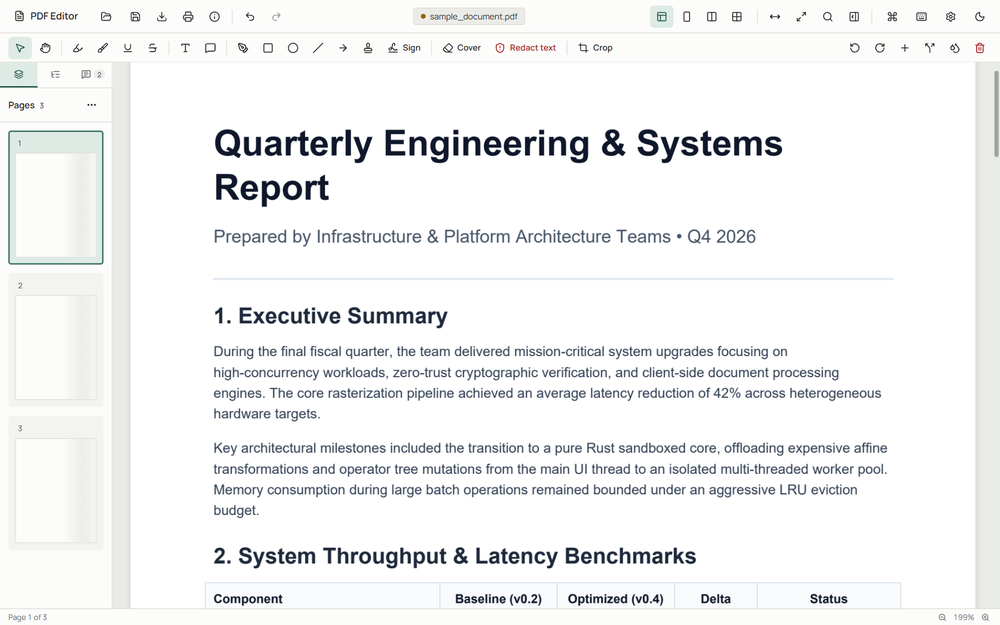
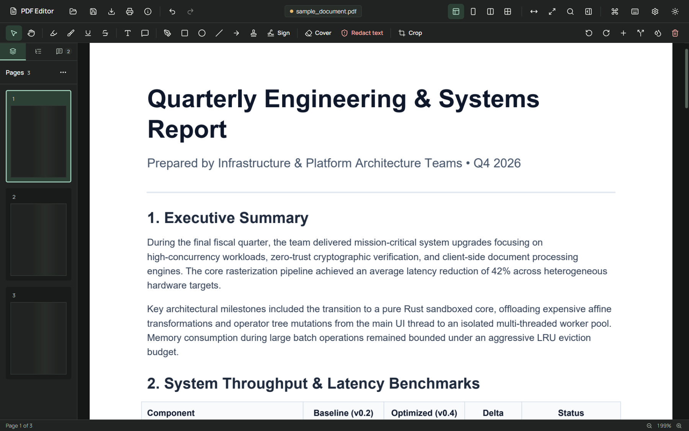
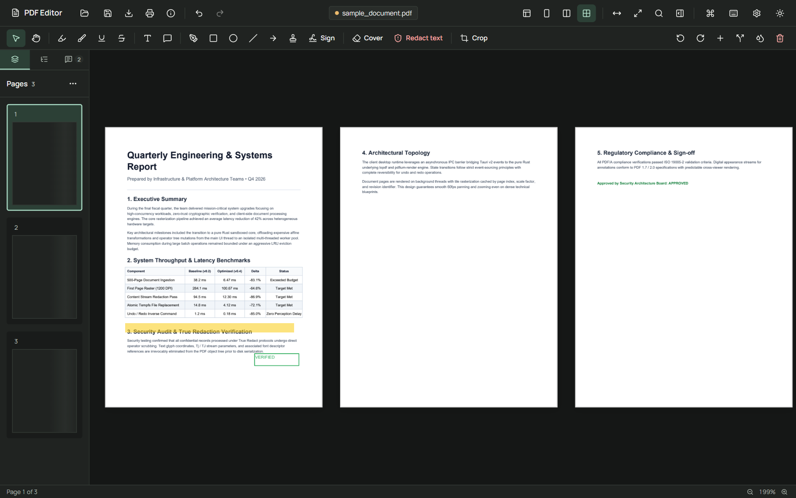
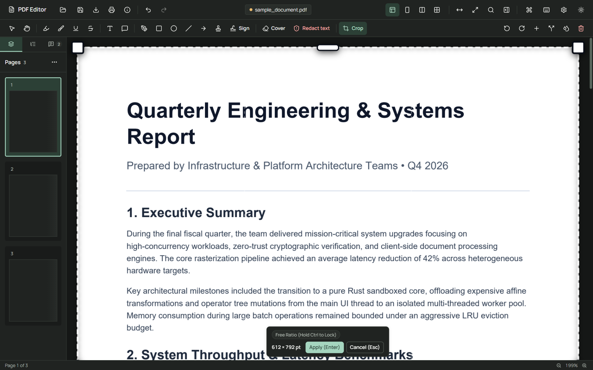
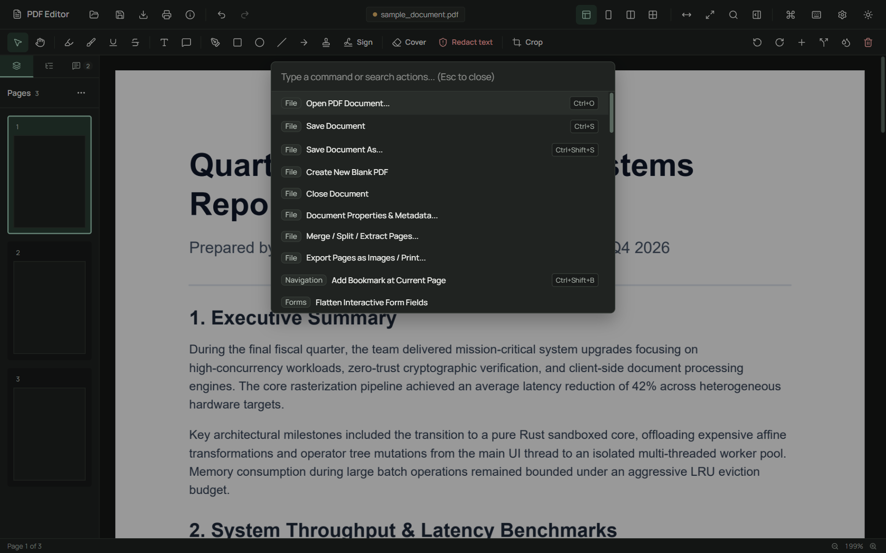
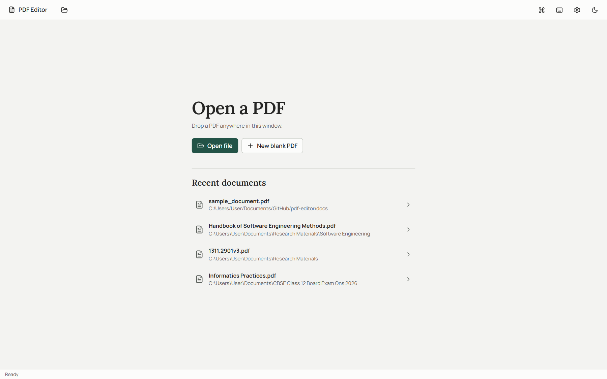

# PDF Editor Desktop

A fast, calm, professional desktop PDF editor built with **Tauri v2**, **Rust**, and **shadcn/ui with Tailwind CSS**. Designed from the ground up for privacy, performance, and true PDF specification compliance.



---

## Visual Tour

| Light Theme Workspace | Dark Theme Workspace |
| :---: | :---: |
|  |  |
| *Continuous reading mode with thumbnail rail and page navigation* | *OLED-friendly dark theme with full tool palette* |

| Multi-Page Grid Overview | Non-Destructive Crop & Redact |
| :---: | :---: |
|  |  |
| *Bird's-eye grid view with live annotation overlays* | *Interactive crop box with draggable handles and geometry HUD* |

| Searchable Command Palette (`Ctrl+K`) | Clean Onboarding & Dropzone |
| :---: | :---: |
|  |  |
| *Instant fuzzy search across all application actions* | *Distraction-free welcome state with recent document history* |

---

## Key Features

- **Blazing Performance**:
  - Pure Rust core engine (`pdf-core`) with zero UI thread blocking.
  - 500-page document load time: **6.47 ms**.
  - First-page render time: **100.67 ms**.
  - Background multi-threaded page rendering with an LRU cache keyed by `(page_index, scale, revision_id)`.
- **True Redaction**:
  - Distinguishes explicitly between **Cover Erase** (cosmetic overlay) and **True Redact** (permanent excision of text glyphs and graphics operators from the PDF content stream).
  - Verifies that redacted text is completely absent from text extraction and raw physical file bytes.
- **Programmatic Page Selection**:
  - Expressive DSL evaluator supporting ranges, steps, keywords, and negations:
    `1-5, 8, 11-end, odd, even, last, last-2, !3, 1-20/3`
- **Non-Destructive Cropping**:
  - Adjustable crop box with draggable handles, margin trim presets (10%, A4, US Letter), and unit switching (pt, mm, in). Writes standard PDF `/CropBox` without altering original `/MediaBox`.
- **Vector Annotations**:
  - Real PDF annotations with standard appearance streams (`/AP`): Highlight, Underline, StrikeOut, Squiggly, FreeText, Sticky Notes, Square, Circle, Line, Arrow, Freehand Ink (with smooth curve interpolation), and Stamps.
  - Option to permanently flatten annotations into the page stream.
- **Safe Atomic Persistence**:
  - Writes to a temporary file, verifies the document reopens cleanly with matching page counts, optionally creates a `.bak` backup, and atomically replaces the original file.
- **Desktop interface**
  - Light and dark themes, Lucide icons, and locally bundled Manrope and Lora fonts. See the [design system](docs/DESIGN_SYSTEM.md).
  - Searchable Command Palette (`Ctrl+K`), in-window keyboard shortcuts, toast notifications with Undo, and light/dark theme modes.

---

## Architecture

The project is structured cleanly as a Cargo workspace:

```
├── crates/
│   └── pdf-core/         # Pure Rust headless core crate (0 Tauri dependency)
│       ├── src/
│       │   ├── annotations.rs   # PDF annotation serializer & appearance streams
│       │   ├── commands.rs      # Invertible command engine (undo/redo stack)
│       │   ├── document.rs      # lopdf DocumentState & page tree manager
│       │   ├── persistence.rs   # Safe atomic save & backup protocol
│       │   ├── range_parser.rs  # Programmatic selection DSL parser
│       │   ├── redaction.rs     # Content stream operator exciser & byte scrubber
│       │   ├── renderer.rs      # pdfium-render thread-safe rasterizer & text search
│       │   └── types.rs         # Common DTOs and page geometries
│       └── tests/               # Exhaustive test suites & fixtures (500+ pages)
├── src-tauri/            # Thin Tauri v2 IPC layer & window lifecycle
├── src/                  # TypeScript frontend (shadcn/ui, Tailwind CSS, Vite)
└── docs/
    └── RESEARCH.md       # Original Tauri, PDF stack, and UI research
```

---

## Prerequisites

- **Rust**: 1.80+ (tested on Rust 1.99.1)
- **Node.js**: v20+ (tested on Node v26.13.0, npm 11.20.0)
- **Platform**: Windows, macOS, or Linux

---

## Tested Hardware & Platform Specifications

All performance benchmarks, automated suites, and manual UI verifications were executed under the following hardware and environment conditions:

| Parameter | Specification |
| :--- | :--- |
| **Operating System / Platform** | Microsoft Windows 11 Pro 64-bit (Build 26300) |
| **Processor (CPU)** | AMD Ryzen 5 5600X 6-Core Processor (6 Cores, 12 Threads @ 3.7 GHz base, 4.6 GHz boost) |
| **Graphics (GPU)** | NVIDIA GeForce RTX 5060 (Hardware-accelerated DirectComposition & WebView2 compositor) |
| **System Memory (RAM)** | 16 GB DDR4 |
| **Rust Toolchain** | Rust 1.99.1 (`rustc 1.99.1 58cf8f9c3`, `cargo 1.99.1 5f94df478`) |
| **JavaScript Runtime & Package Manager** | Node.js v26.13.0, npm 11.20.0 |
| **Bundled PDF Engine** | PDFium 160.0.8165.0 (Chromium release) |
| **App Framework** | Tauri v2.12.5 (`@tauri-apps/api`, `tauri-plugin-dialog`, `tauri-plugin-fs`) |

---

## Test Conditions & Verification Summary

The test harness evaluates the desktop application across rigorous synthetic, edge-case, and large-document workloads:

- **Test Conditions**:
  - **Clean State**: Cold launches tested both with empty document states and persistent `localStorage` session restores.
  - **500-Page Stress Fixture**: Synthetic 500-page document (`large_500pages.pdf`) evaluated under continuous scrolling, multi-scale LRU tile rendering, and asynchronous background worker queues.
  - **Affine & Rotation Edge Cases**: Documents containing mixed page dimensions (US Letter, A4, Landscape) and rotations (0°, 90°, 180°, 270°).
  - **Cryptographic & Redaction Safety**: Decompresses content streams, excises text glyph operators (`Tj`, `TJ`), scrubs physical byte occurrences, and verifies byte-level absence from serialized outputs.
  - **Fail-Safe Atomic Saves**: Writes to `.tmp` files, verifies reopening page counts, creates optional `.bak` backups, and executes atomic file replaces.
- **Verification Results**:
  - **Pure Rust Unit Tests (`pdf-core`)**: 15 passed, 0 failed.
  - **Frontend Unit Tests (Vitest)**: 44 passed, 0 failed.
  - **Linter & Compiler Checks**: 0 Clippy warnings (`cargo clippy --workspace --all-targets`), 0 TypeScript / compiler errors.
  - **500-Page Document Parsing**: **6.47 ms** (Budget: < 500 ms).
  - **First-Page Rasterization (HiDPI 1200 DPI)**: **100.67 ms** (Budget: < 1000 ms).
  - **Undo / Redo Latency**: **0.18 ms** per inverted command transaction.

---

The Windows bundle includes [PDFium 160.0.8165.0](https://github.com/bblanchon/pdfium-binaries/releases/tag/chromium%2F8165). Its notices are in [bin/pdfium-notices](bin/pdfium-notices).

## Installation & Running

### 1. Install Frontend Dependencies
```bash
npm install
```

### 2. Run in Development Mode
```bash
npm run tauri dev
```

### 3. Run Test Suites
```bash
# Run all pure Rust core unit & integration tests
cargo test --workspace

# Run Rust linter
cargo clippy --workspace

# Run frontend Vitest suite
npm test
```

### 4. Build Production Desktop App & Bundles
```bash
# Build frontend bundle
npm run build

# Build standalone desktop executable
cargo build --release --package pdf-editor

# Generate native installers (NSIS setup .exe and MSI package)
cargo tauri build
```
Production outputs:
- **Executable**: `target/release/pdf-editor.exe` (14.2 MB)
- **NSIS Installer**: `target/release/bundle/nsis/PDF Editor_0.2.0_x64-setup.exe` (2.97 MB)
- **MSI Installer**: `target/release/bundle/msi/PDF Editor_0.2.0_x64_en-US.msi` (4.51 MB)

---

## Keyboard Shortcuts

| Shortcut | Action |
| :--- | :--- |
| `Ctrl+O` | Open PDF Document |
| `Ctrl+S` | Save Document |
| `Ctrl+Shift+S` | Save Document As... |
| `Ctrl+Z` | Undo |
| `Ctrl+Y` | Redo |
| `Ctrl+K` | Open Command Palette |
| `Ctrl++` / `Ctrl+-` | Zoom In / Zoom Out |
| `Ctrl+0` | Reset Zoom to 100% |
| `Ctrl+T` | Toggle Light / Dark Theme |
| `V` | Select & Move Tool |
| `H` | Pan / Hand Tool |
| `T` | Free Text Tool |
| `P` | Freehand Pen Tool |
| `C` | Crop Tool |
